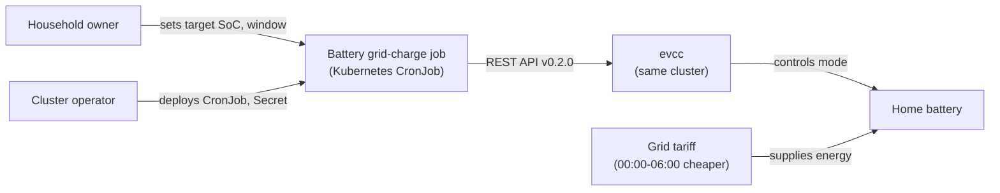
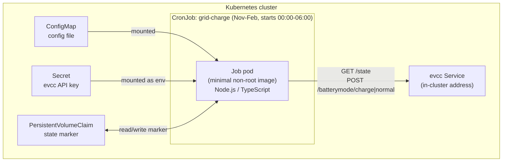

## Context

The home battery cannot be charged from solar during winter days, so it is low when evening consumption starts. evcc already controls the battery and exposes an external battery mode through its REST API (version 0.2.0 as listed in the docs). evcc runs inside the same Kubernetes cluster as this job.

Current state: no code exists yet. The job is new and runs once per night as a Kubernetes CronJob.

Constraints:
- evcc resets an external battery mode after 60 seconds, so the mode must be re-sent while charging.
- The job runs in a minimal, non-root container. Each CronJob run is a fresh pod, so any state must live outside the pod.
- The API key comes from a Kubernetes Secret.
- The job must not override a charge started by a user.

Stakeholders: the household energy owner (sets the target and tariff window) and the cluster operator (deploys the CronJob).

## Goals / Non-Goals

**Goals:**
- Charge the home battery from the grid to a target state of charge during the 00:00 to 06:00 window, November to February.
- Always return the battery to `normal` mode when the run ends, including after errors, and let evcc's 60-second reset act as the backstop if the process is killed.
- Make every run observable through logs and exit codes.

**Non-Goals:**
- Multiple batteries or sites.
- Tariff or dynamic price optimisation.
- Notifications beyond logs.
- Coordination with evcc's own charging logic.

## Architecture

### System context

### Containers

The job is a single container. It has no long-running server, queue, or database.

## Decisions

### Decision: one-shot Node.js/TypeScript process, not a daemon
The CronJob owns scheduling, so the process runs a single charge session and exits. This avoids a second scheduler and matches the Kubernetes model.
- Alternative: long-running process with an internal scheduler. Rejected: duplicates CronJob scheduling and keeps a pod running all day.

### Decision: state marker on a PersistentVolumeClaim
Startup recovery needs to know whether this job started the current charge. Each run is a new pod, so the marker is written to a small PVC mounted into the pod. The marker holds the start time and is deleted after a clean restore.
- Alternative: ConfigMap written by the job. Rejected: the job would need RBAC to patch ConfigMaps, which widens its permissions.
- Alternative: infer ownership from charge start time alone. Rejected: a user charge at the same hour would be misidentified.

### Decision: keep-alive every 30 seconds
evcc resets external mode after 60 seconds. Re-sending every 30 seconds leaves one missed refresh of margin.
- Alternative: every 10 seconds. Rejected: more API traffic with no benefit.

### Decision: restore by setting `normal` explicitly
`POST /batterymode/normal` is the restore call, as chosen by the owner. The alternative `DELETE /batterymode` restores evcc default control and was not chosen.

### Decision: evcc API key as bearer token from a Secret
The job uses an `evcc_` API key from a Kubernetes Secret, mounted as an environment variable. Cookie auth is unsuitable for a headless job.

### Decision: configuration in a ConfigMap file
Target SoC, maximum duration (2 hours), no-progress timeout, HTTP timeouts, and the evcc URL live in a mounted config file. Changes take effect on the next run, since each run reads the file at start.

### Decision: injectable clock for time-based stops
The 2-hour maximum duration, the 06:00 window end, and the no-progress timeout depend on elapsed and wall-clock time. Acceptance scenarios cannot wait for these, so the job reads the current time through a clock seam. In production the seam is the system clock. The acceptance suite sets the environment variable `EVCC_TEST_CLOCK` to an ISO-8601 start time and the job advances that clock only through the test harness control. When the variable is unset, the system clock is used. The variable is documented as test-only and is not set in the CronJob manifest.
- Alternative: time scaling in config. Rejected: a speed-up knob in production config.
- Alternative: unit tests only for these stops. Rejected: loses the end-to-end process check.

### Decision: schedule owned by the CronJob manifest
The months (November to February), daily start time within 00:00 to 06:00, and time zone are set in the CronJob manifest. `concurrencyPolicy: Forbid` prevents overlapping runs. `startingDeadlineSeconds` is set so a missed start is skipped rather than run late into the day.

## Risks / Trade-offs

- [Process killed mid-charge (SIGKILL, OOM, node loss)] -> evcc's 60-second reset returns control to evcc. The startup check clears any marker-recorded charge on the next run.
- [evcc unreachable for a whole night] -> No grid charge that night. Logged as a non-zero exit. The next night retries.
- [SoC never rises (faulty sensor)] -> The no-progress timeout stops the charge, and the 2-hour maximum is the second limit.
- [Charge runs past 06:00] -> The window end check stops the charge at 06:00.
- [Net saving smaller than expected after round-trip losses] -> Unconfirmed. Measure winter imports before tuning the target.
- [PVC unavailable] -> The job cannot write the marker. It refuses to start the charge and exits non-zero, so no unrecorded charge runs.
- [Target above battery limits] -> Target must stay within manufacturer and evcc limits. Validation rejects values outside 0-100 only.

## Migration Plan

1. Deploy the PVC, ConfigMap, Secret, and CronJob with `suspend: true`.
2. Run the job once manually in dry-run mode and confirm the logged mode changes match `/state`.
3. Run once for real during the day with a low target to confirm `charge` and `normal` mode transitions.
4. Unsuspend the CronJob for the November to February schedule.

Rollback: set `suspend: true` on the CronJob, then run the job once more to ensure the battery is in `normal` mode. Check `/state` `batteryMode`.

## Resolved Decisions

- evcc release: version 0.317.1 ships REST API version 0.2.0. The evcc deployment is pinned to 0.317.1, and the job is tested against that release.
- Default target state of charge: 100%. The config file can override it.
- Failed job runs are reported only in logs. No notifications are sent, consistent with the non-goal in the proposal.
- `charge` mode: confirmed by the owner to enable grid charging on evcc.

## Open Questions

- No existing ADRs exist in `adr/`, so no earlier decisions constrain this design.
